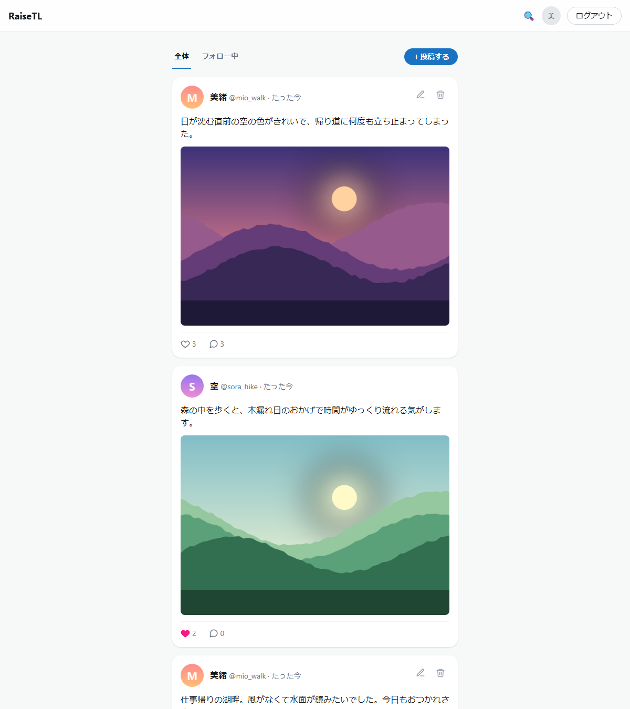
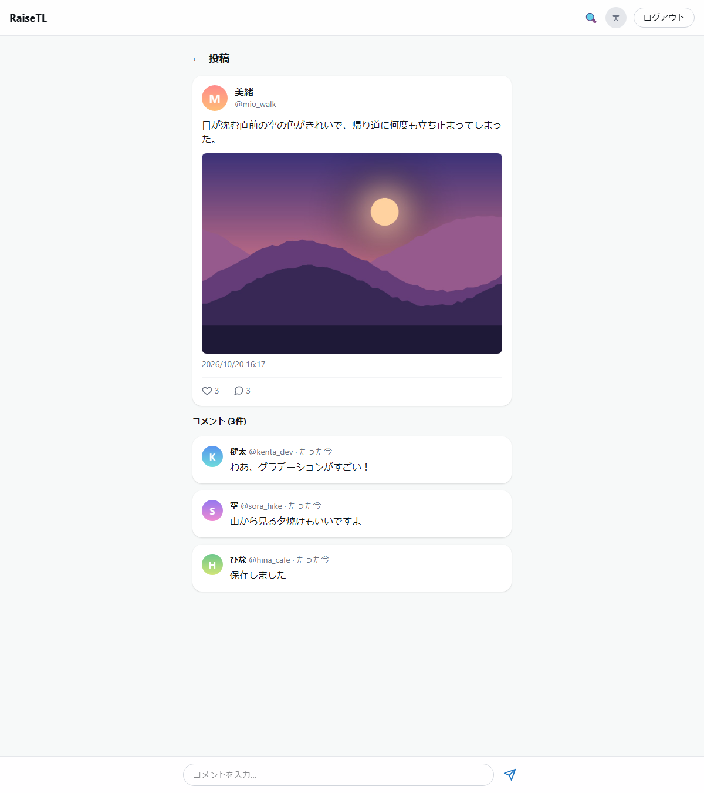
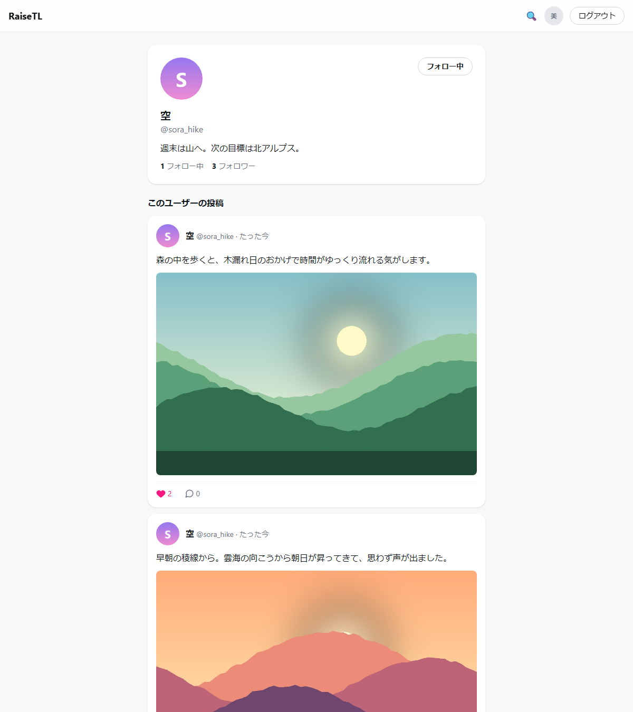
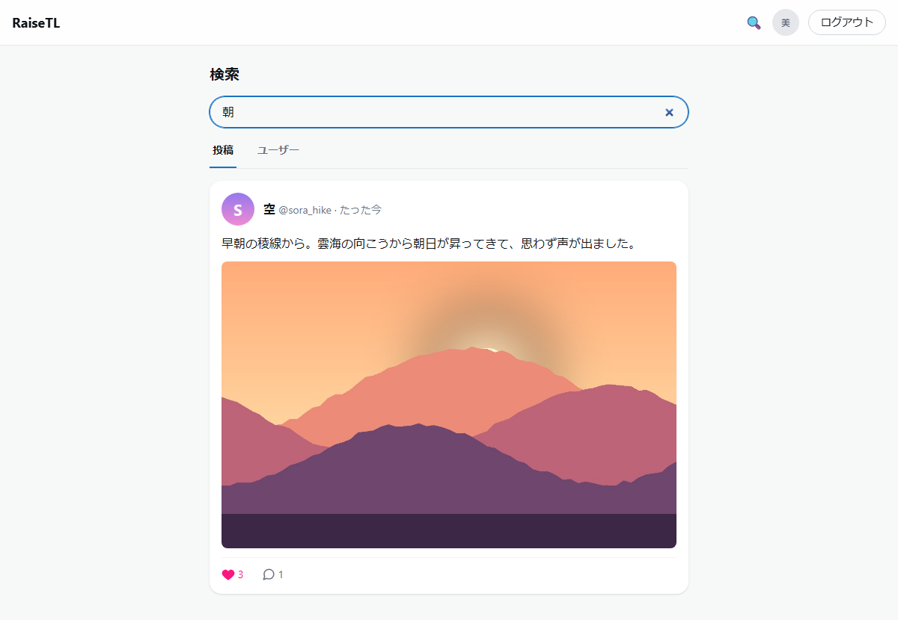
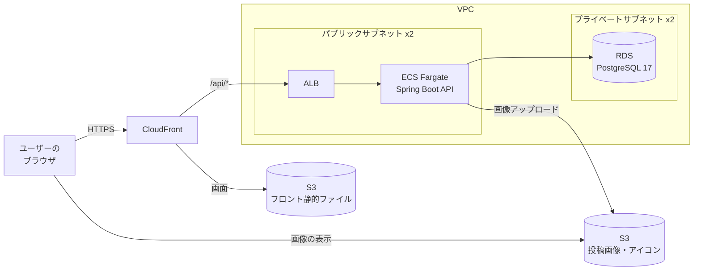

# RaiseTimeLine — X風タイムラインSNSアプリ

[](https://github.com/yusu31/RaiseTimeLine/actions/workflows/ci.yml)

X（旧Twitter）のタイムライン形式を参考にした、テキストベースのSNS風Webアプリです。
プログラミングスクール RaiseTech の課題として、講師の講義進行に合わせて学習目的で開発しました。

> アプリ名「RaiseTimeLine」は仮称です。

**現在の状況:** 機能 F-01〜F-12 はすべて実装済みです。AWS 上（CloudFront + S3 / ECS Fargate + ALB / RDS）への
デプロイ構成は Terraform で定義し、`apply` → 動作確認 → `destroy` まで実機で検証しています。
常時公開はしていません（理由は「[公開について](#公開について常時稼働させていない理由)」）。


> 上の動画は、投稿 → いいね → コメント → フォローの一連の操作です（架空のユーザー・自作イラストを使っています）。

---

## 主な機能

| 機能 | 内容 | ID |
|------|------|----|
| ユーザー登録・ログイン | メールアドレス + パスワード、JWT認証（アクセス + リフレッシュトークン） | F-01 / F-06 |
| テキスト投稿・タイムライン | 280文字制限。全ユーザーの投稿を新着順で表示。「全体 / フォロー中」のタブ切替 | F-02 |
| 新着チェック | 30秒ごとに新着を確認し、「N件の新着を表示」バナーで知らせる（勝手に画面は動かさない） | F-12 |
| 画像添付 | 1枚・JPEG/PNG・5MB以内。保存先はローカル / AWS S3 を設定で切替 | F-05 |
| いいね・コメント | 第三者の投稿にも可能。二重いいねはDBのユニーク制約で防止 | F-03 / F-04 |
| 投稿の編集・削除 | 自分の投稿のみ（権限チェック） | F-08 |
| プロフィール | アイコン・@ユーザー名・自己紹介・投稿一覧 | F-07 |
| 検索 | 投稿本文のキーワード検索 / ユーザー名・表示名の検索 | F-09 / F-10 |
| フォロー / フォロワー | プロフィールからフォロー。フォロー・フォロワー一覧 | F-11 |

受け入れ条件は [機能一覧](./docs/features.md) にあります。

### X/Twitterとの差別化

- インプレッション数（表示回数）を**表示しない**
- リツイート（リポスト）機能を**用意しない**

## 画面

| タイムライン | 投稿詳細（コメント） |
|---|---|
|  |  |

| プロフィール | 検索 |
|---|---|
|  |  |

ログイン画面は [こちら](./docs/images/01-login.png)。画像は `e2e/showcase/capture.mjs` で再生成できます
（撮影専用のDBに架空のデータを投入して撮影します）。

---

## 構成図

ブラウザから見た入口は CloudFront の1つだけです。`/api/` で始まるパスだけが ALB 経由で API へ、
それ以外は S3 の画面ファイルへ振り分けられます（画面と API が同じオリジンになるため、フロントは相対パスで API を呼べます）。



ネットワーク設計・各コンポーネントの役割・EC2 と Fargate の比較・コストは
[docs/infrastructure.md](./docs/infrastructure.md) にまとめています（構成の正本はこちらです）。

### 公開について（常時稼働させていない理由）

ALB・Fargate・RDS・公開IPv4 は**稼働している時間だけ課金される**ため、学習用途では
`terraform apply` → 動作確認 → `terraform destroy` の運用にしています。そのため常設のURLはありません。

- 実際に動かした結果・料金の内訳は [docs/infrastructure.md](./docs/infrastructure.md) の「コスト管理」に記録しています
- 画面は上のスクリーンショットと、ローカルで動かせる「起動手順」で確認できます
- 構成は `terraform/` のコードで再現できます

---

## 技術スタック

| 役割 | 技術 | バージョン |
|------|------|-----------|
| フロントエンド | React + TypeScript + Vite + Tailwind CSS | React 19.2 / TS 6.0 / Vite 8 / Tailwind 4 |
| バックエンド | Java + Spring Boot（REST API） | Java 25 / Boot 4.0.8 |
| 認証 | Spring Security + JWT | - |
| ORマッパー / マイグレーション | MyBatis（SQLは Mapper XML に記述） / Flyway | - |
| データベース | PostgreSQL（ローカルは Docker） | 17 |
| 画像ストレージ | AWS S3 | - |
| インフラ | AWS: CloudFront + S3 / ECS Fargate + ALB / RDS（IaC は Terraform。EC2 は使わない） | - |
| テスト | JUnit（バックエンド） / Vitest + Testing Library（フロント） / Playwright（E2E） / k6（負荷試験） | - |
| CI | GitHub Actions（lint・テスト・ビルド。緑でないとマージできない） | - |

選定理由・採用しなかった技術は [docs/tech-stack.md](./docs/tech-stack.md) を参照してください。

---

## テスト

実装とテストは同じPRに入れる方針です。ケースは同値分割・境界値分析・デシジョンテーブルで設計しています
（[docs/testing-design.md](./docs/testing-design.md)）。

```powershell
# フロントエンド
cd frontend
npm run lint       # ESLint
npm run test:run   # Vitest（実行件数が表示されることも確認する）
npm run build      # 型チェック + ビルド

# バックエンド（実DBに接続するので、先に docker compose up -d）
cd backend
./gradlew build    # ビルド + テスト
```

| 種類 | 場所 | 実行方法・詳細 |
|------|------|---------------|
| E2E（ブラウザ操作） | `e2e/` | [e2e/README.md](./e2e/README.md) / [docs/e2e-testing.md](./docs/e2e-testing.md) |
| 負荷試験（k6） | `perf/` | [perf/README.md](./perf/README.md) / [docs/performance-testing.md](./docs/performance-testing.md)（CIでは自動実行しない） |

---

## ドキュメント一覧

| ドキュメント | 内容 |
|-------------|------|
| [要件定義書](./docs/requirements.md) | プロジェクト全体像の目次役（ペルソナ・非機能要件・リスク） |
| [機能一覧](./docs/features.md) | 機能 F-01〜F-12（受け入れ条件つき）・ユースケース |
| [画面設計書](./docs/screen-design.md) | 画面一覧・画面遷移図・ワイヤーフレーム・デザイン方針 |
| [データベース設計書](./docs/database-design.md) | ER図・テーブル定義・インデックス・マイグレーション |
| [設計書（API）](./docs/design.md) | システム構成・JWT認証フロー・APIエンドポイント・エラー形式 |
| [技術スタック](./docs/tech-stack.md) | 使用技術・バージョン・選定理由・採用しない技術 |
| [インフラ構成](./docs/infrastructure.md) | 構成図・ネットワーク設計・デプロイ手順・コスト（確定版） |
| [テスト設計](./docs/testing-design.md) | テストケースの設計方法（同値分割・境界値分析など） |
| [E2Eテスト](./docs/e2e-testing.md) / [負荷試験](./docs/performance-testing.md) | ツール選定理由・シナリオ・しきい値 |
| [運用設計書](./docs/operations.md) | ログ設計・監視項目・障害対応フロー |
| [docs/features/](./docs/features/) | 機能別の詳細設計（実装直前に作成） |

> **ドキュメント運用ルール:** requirements.md は「目次役」とし、詳細は各分冊に1か所だけ書く（重複させない）。
> ドキュメントは実装を「正」として随時修正する。

---

## ディレクトリ構成

```
RaiseTimeLine/
├── backend/        # Java + Spring Boot（REST API）
├── frontend/       # React + TypeScript（Vite）
├── e2e/            # E2Eテスト（Playwright）
├── perf/           # 負荷試験（k6）
├── terraform/      # AWS構成のIaC（VPC・RDS・ECR・ECS・ALB・S3・CloudFront）
├── docker/         # ローカルDB（PostgreSQL）の初期化設定
├── prototype/      # 静的プロトタイプ（HTML/CSS/JSのみ、DBなし）
├── docs/           # 要件定義・設計ドキュメント
│   └── features/   # 機能別詳細設計
├── .github/        # CI（GitHub Actions）・Issue/PRテンプレート
├── docker-compose.yml
├── CLAUDE.md       # AI開発アシスタント向けプロジェクトルール
└── README.md
```

## 静的プロトタイプ

実装前の画面・操作感確認用に、HTML/CSS/JavaScriptのみの静的プロトタイプ（SPA形式）を用意しています（DB・サーバー不使用、疑似データはブラウザのlocalStorageに保持）。

```
prototype/index.html をブラウザで開く（file://でも動作するが、ローカルサーバー推奨）
テストアカウント: suzuki@example.com / password123 など（画面内に記載）
```

---

## 開発ワークフロー

```
Issue作成 → ブランチ作成 → 実装 → ローカルで動作確認 → PR作成 → マージ → クリーンアップ
```

- ブランチ命名: `{type}/{説明}-#{Issue番号}`（例: `feature/timeline-api-#5`）
- コミットメッセージ: `{type}: {日本語説明}` + `Closes #番号`
- **main への直接プッシュ禁止**（ブランチ保護ルールで強制）・force push 禁止・**CIが緑でないとマージ不可**
- PRマージ後、リモートブランチは自動削除される設定

---

## 起動手順

ポートはフロントエンド 5173 / バックエンド 8080 / DB 5432 で固定です（変更禁止。理由は [docs/tech-stack.md](./docs/tech-stack.md) 参照）。

```powershell
# 1. DB起動（初回・DBコンテナが落ちている時のみ）
docker compose up -d

# 2. バックエンド起動
cd backend
./gradlew bootRun

# 3. フロントエンド起動（別ターミナル）
cd frontend
npm install   # 初回のみ
npm run dev
```

起動後、ブラウザで http://localhost:5173 を開くと新規登録・ログイン画面が表示されます。

### 画像の保存先について

通常の開発では**何も設定する必要はありません**。画像はバックエンドの `backend/uploads/` に保存されます
（AWSの認証情報も不要です）。

AWS S3 に保存する動作を確認したいときだけ、環境変数を指定して起動します。

```powershell
# S3モードで起動する（AWSの認証情報が必要）
cd backend
$env:APP_STORAGE_TYPE = "s3"
$env:APP_STORAGE_S3_BUCKET = "<バケット名>"
$env:AWS_PROFILE = "<プロファイル名>"
./gradlew bootRun
```

| 環境変数 | 既定値 | 説明 |
|---|---|---|
| `APP_STORAGE_TYPE` | `local` | `local` = ローカル保存 / `s3` = AWS S3 |
| `APP_STORAGE_S3_BUCKET` | （空） | S3モードでは必須。未設定なら起動時にエラーで止まる |
| `APP_STORAGE_S3_REGION` | `ap-northeast-1` | バケットのリージョン |

> **`APP_STORAGE_TYPE` を設定しなければ必ずローカル保存になります。**
> 設定漏れでS3が有効になり、意図しない課金が発生することを防ぐための既定値です。
> S3側の構成（バケット・IAM・公開範囲）は [docs/infrastructure.md](./docs/infrastructure.md) を参照してください。

---

## 課題提出ファイル（RaiseTech）

| ファイル | 内容 |
|----------|------|
| [理解度チェック（中級編No.34）](docs/assignments/understanding-check-intermediate.md) | 認証・アーキテクチャ・インフラ・テスト等に関する中級編理解度チェック回答 |

---

## ライセンス

[MIT License](./LICENSE)
