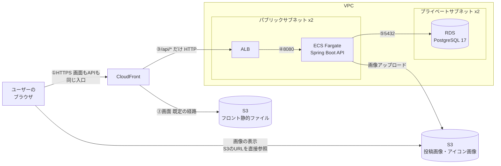

# インフラ構成図（確定版）

## RaiseTimeLine（仮称）

| 項目 | 内容 |
|------|------|
| ステータス | **確定版**（Terraform Issue1〜9で構築し、実機で動作確認済み。2026-10-16） |
| 構成 | フロントは **S3 + CloudFront**、バックエンドは **ECS Fargate**、DBは **RDS（PostgreSQL 17）**、API入口は **ALB**。画像は **S3**。**EC2は使用しない**（経緯は「2.5 EC2不採用の経緯」） |
| コードの場所 | `terraform/`（1ファイル1役割: `vpc.tf` `security_groups.tf` `rds.tf` `ecr.tf` `ecs.tf` `iam.tf` `alb.tf` `secrets.tf` `cloudfront.tf`） |
| 運用方針 | 課金リソースは **apply → 動作確認 → destroy**。常時稼働させない。独自ドメインなし |

> 本書の数値・名前は `terraform/` の実コードに合わせてある（**ドキュメントは実装を正とする**）。
> 食い違いを見つけたら、コードではなく本書を直す。

---

## 1. 構成図



> ①〜⑤は「投稿が表示されるまでのリクエストの流れ」の順番。ブラウザから見ると**入口はCloudFront1つだけ**で、
> パスが `/api/` で始まるものだけがALBへ、それ以外は画面（S3）へ振り分けられる。
> このため画面とAPIは同じオリジンになり、フロントは `fetch('/api/...')` と相対パスで呼べる（接続先の設定が要らない）。

### 各コンポーネントの役割

| コンポーネント | 役割 | 補足 |
|--------------|------|------|
| CloudFront | 画面のCDN配信と、`/api/*` のALBへの中継 | HTTPSの終端もここ。証明書は `*.cloudfront.net` の既定証明書 |
| S3（フロント用） | React ビルド成果物の置き場 | 非公開。CloudFrontだけが読める（「6. 配信経路」）。画像用S3とは別バケット |
| ALB | `/api/*` のリクエストをECSのコンテナへ振り分ける入口 | ヘルスチェック（`/actuator/health`）で動いているコンテナだけに流す |
| ECS Fargate | Spring Boot（REST API）をコンテナとして動かす実行環境 | サーバー（EC2のような土台）の存在を意識せずコンテナを動かせる |
| RDS（PostgreSQL） | データベースのマネージドサービス | バックアップ・パッチ適用をAWSが管理。外部公開しない |
| S3（画像用） | 投稿画像・アイコン画像の保存先 | 画像はS3のURLで直接配信。詳細は「5. S3の確定仕様」 |

> **ロードバランサーを入れる理由（学習メモ）:** 本来は複数サーバーへの負荷分散が目的だが、
> サーバー1台でも「ヘルスチェック」「将来の台数追加への備え」として入れる構成が実務では一般的。

---

## 2. ローカル開発環境との対応

| 役割 | ローカル開発 | 本番（確定） |
|------|-------------|------------|
| フロントエンド | Vite 開発サーバー（ポート5173） | ビルド成果物をS3 + CloudFrontで配信 |
| バックエンド | Spring Boot（ポート8080） | ECS Fargate上のコンテナでSpring Boot |
| データベース | Docker の PostgreSQL 17（ポート5432） | RDS（PostgreSQL 17） |
| 画像保存 | 既定は**ローカル保存**（`backend/uploads/`）。`APP_STORAGE_TYPE=s3` でS3にも切替可能 | S3（画像用バケット） |

## 2.5 EC2不採用の経緯

要件定義時点ではEC2を前提としていたが、講義No.38（2026-10-13）で ECS Fargate を採用する方針に変更した。

| 案 | 内容 | 判断 |
|----|------|------|
| **採用: ECS Fargate** | コンテナの実行環境をAWSに任せる | サーバー（OS）のパッチ適用・スケーリング設定を自分で管理する必要がなく、学習コスト・運用負荷の両方で有利 |
| 却下: EC2上に自分でAPIサーバーを構築 | EC2インスタンス上でSpring Bootを直接動かす | OSの保守・スケーリングを自前で管理する必要があり、構成がEC2単体に固定されると将来の台数追加や入れ替えがしにくい |

> **却下したが記録として残す理由:** 前回課題（TaskManagement）までEC2前提で設計してきた経緯があり、
> 「なぜ今回はEC2を使わないのか」を後から見返せるようにしておく。

---

## 3. ネットワーク・実行環境の確定仕様

### 3.1 VPC・サブネット（`vpc.tf`）

| 項目 | 値 |
|------|-----|
| VPC | `10.0.0.0/16` |
| アベイラビリティゾーン | `ap-northeast-1a` / `ap-northeast-1c` の2つ（ALBとRDSのサブネットグループが2AZを要求するため） |
| パブリックサブネット | `10.0.1.0/24` `10.0.2.0/24`。ALBとECSを置く。インターネットゲートウェイへの経路あり |
| プライベートサブネット | `10.0.11.0/24` `10.0.12.0/24`。**RDS専用**。インターネットへの経路なし |

### 3.2 セキュリティグループ（`security_groups.tf`）― 通信を許可する相手を1つずつに絞る

| SG | 入ってくる通信を許可する相手 | 理由 |
|----|----------------------------|------|
| ALB用 | **CloudFrontのIP範囲だけ**（AWS管理のプレフィックスリスト `com.amazonaws.global.cloudfront.origin-facing`）の80番 | ALBのURLを直接叩いてCloudFrontを迂回する経路を塞ぐ |
| ECS用 | **ALB用SGからの8080番だけ** | コンテナはALB経由でしか届かない（パブリックIPを持っていても直接は入れない） |
| RDS用 | **ECS用SGからの5432番だけ** | DBはアプリからしか届かない |

### 3.3 RDS（`rds.tf`）

| 項目 | 値 |
|------|-----|
| エンジン | PostgreSQL 17.11 / `db.t4g.micro` / 20GB（`gp2`）/ **Single-AZ**（無料利用枠の条件） |
| 公開 | `publicly_accessible = false` ＋ プライベートサブネットのみ |
| マスターパスワード | **RDSが自動生成してSecrets Managerに保管**（`manage_master_user_password`）。コードに平文で書かない |
| 最終スナップショット | 取らない（`skip_final_snapshot`）。apply→確認→destroy の運用のため |
| スキーマ | アプリ起動時に **Flywayが自動適用**（V1〜V8） |

### 3.4 ECS Fargate（`ecs.tf` / `iam.tf` / `secrets.tf`）

| 項目 | 値 |
|------|-----|
| タスク定義 | CPU **256**（0.25vCPU）/ メモリ **512MB** / `X86_64` / タスク数（`desired_count`）**1** |
| イメージ | ECRの `raisetimeline-backend:latest`（ECRは直近5イメージだけ保持、push時に脆弱性スキャン） |
| 配置 | パブリックサブネット2つ。**パブリックIPを付与**（理由は「7. 却下した案」のNAT Gateway不採用） |
| ログ | CloudWatch Logs `/ecs/raisetimeline-backend`（保持7日） |
| 起動時間 | Spring Bootの起動に**約91秒**かかるため、ヘルスチェックの猶予（`health_check_grace_period_seconds`）を **180秒** にしている。猶予が短いと「起動中に不健康と判定されて殺される」を繰り返す |
| ヘルスチェック（ALB） | `/actuator/health` が200 / 30秒間隔 / 2回連続成功で健康・3回連続失敗で不健康 |
| 環境変数 | `SPRING_PROFILES_ACTIVE=prod` / DB接続URL・ユーザー名 / `APP_STORAGE_TYPE=s3` と画像バケット名 / `CORS_ALLOWED_ORIGINS`（CloudFrontのドメイン） |
| シークレット | `SPRING_DATASOURCE_PASSWORD`（RDSが作ったパスワード）と `JWT_SECRET` を**Secrets Managerから実行時に注入** |

**JWT署名鍵:** Terraformが48文字のランダム値を生成し、Secrets Manager（`raisetimeline-jwt-secret`）に保管する。
リポジトリは公開で `application.yml` の既定値は誰でも読めるため、本番でその値が使われないよう、
`prod` プロファイルでは**鍵が渡されていないと起動に失敗する**ようにしてある（渡し忘れに気づける）。
destroy後の再作成で名前が衝突しないよう、削除の猶予期間は0日にしてある。

**IAMロールは2つに分離**（`iam.tf`）:

| ロール | 使われる場面 | 権限 |
|--------|------------|------|
| タスク実行ロール | **コンテナが起動する前**（ECSの仕組み側が使う） | ECRからのイメージ取得・ログ出力・上記2つのシークレットの読み取り |
| タスクロール | **アプリが動いている間**（アプリのコードが使う） | 画像バケットへの `s3:PutObject` / `s3:DeleteObject` **のみ**（画像の表示はS3の公開URLの直接参照なので読み取り権限は不要） |

> 分ける理由: アプリが乗っ取られても、持っている権限が「画像の書き込みと削除」だけなら被害が限られる。
> シークレットを読む権限はアプリ側に持たせない。

---

## 4. デプロイ手順

前提: AWS CLI・Docker・Terraform が使えること。`terraform/terraform.tfvars` に `image_bucket_name` を設定済みであること
（`terraform.tfvars.example` を参照。実値はGitに入れない）。以下のコマンドは `terraform output` の値を使う。

### 4.1 インフラの作成（課金が始まる）

```powershell
cd terraform
terraform init
terraform plan -out=tfplan   # 作られるリソース数を確認してから進める
terraform apply tfplan       # ALB・RDS・Fargate等の課金が始まる。確認が終わったら destroy する
```

### 4.2 バックエンド（イメージを作ってECRに送り、ECSに入れ替えさせる）

```bash
cd terraform
ECR=$(terraform output -raw ecr_repository_url)
aws ecr get-login-password --region ap-northeast-1 | docker login --username AWS --password-stdin "${ECR%%/*}"
docker build -t "$ECR:latest" ../backend
docker push "$ECR:latest"
aws ecs update-service --cluster raisetimeline-cluster --service raisetimeline-backend --force-new-deployment
```

> `latest` タグを使い回すため、push しただけではECSは新しいイメージに気づかない。
> `--force-new-deployment` で「今のタスクを新しいイメージで入れ替える」。

### 4.3 フロント（ビルドしてS3に置き、CloudFrontのキャッシュを消す）

```bash
cd frontend && npm run build
cd ../terraform
aws s3 sync ../frontend/dist/ "s3://$(terraform output -raw frontend_bucket_name)" --delete
aws cloudfront create-invalidation --distribution-id "$(terraform output -raw cloudfront_distribution_id)" --paths "/index.html"
```

> `assets/` 配下のファイル名にはビルドごとにハッシュが付くため、キャッシュを消す必要があるのは `index.html` だけ。
> SPAの深いURL（`/posts/1` など）はCloudFront Functionが `/index.html` に書き換えるので、無効化もこの1つで足りる。

### 4.4 動作確認

1. ECSサービスのタスクが `RUNNING` で、ターゲットグループのヘルスが `healthy` になるまで待つ（起動に約2〜3分）
2. ブラウザで `https://<terraform output の cloudfront_domain_name>/` を開き、新規登録 → 投稿 → 画像付き投稿 → ページ再読み込み（`/posts/1` 等の深いURLを直接開いても表示される）
3. ログ確認: `aws logs tail /ecs/raisetimeline-backend --follow`

> ALBのURLを直接 `curl` しても**つながらない**（3.2のとおりCloudFront以外は遮断）。これは正常。

### 4.5 後片付け

```powershell
cd terraform
terraform destroy   # 課金リソースを消す。終わったらAWSコンソールかCLIで残っていないことを確認する
```

課金が発生する主なリソースは **ALB・RDS・Fargateタスク・パブリックIPv4アドレス**（無料利用枠を超えた分）。
画像用S3バケット（「5」）はTerraform管理外なので、destroyしても残る。

---

## 5. S3の確定仕様（2026-09-02 実装・実機検証済み）

### リソース

| 項目 | 値 |
|------|-----|
| バケット名 | `raisetimeline-dev-578760237100` |
| リージョン | `ap-northeast-1`（東京） |
| バージョニング | **無効**（有効だと削除しても実体が残り、課金が積み上がるため） |
| 暗号化 | S3の既定（`AES256`）をそのまま使用 |
| IAMユーザー | `raisetimeline-app`（アプリ専用。`Administrator` は使わない） |
| IAMポリシー | `RaiseTimeLineS3Access` |

> バケット名にアカウントIDを含めているのは、S3のバケット名が**全世界で一意**である必要があるため。

### IAMポリシー（最小権限）

対象バケット以外には一切アクセスできない。

| 許可 | 対象 |
|------|------|
| `s3:PutObject` / `s3:GetObject` / `s3:DeleteObject` | `arn:aws:s3:::raisetimeline-dev-578760237100/*` |
| `s3:ListBucket` | `arn:aws:s3:::raisetimeline-dev-578760237100` |

`s3:ListAllMyBuckets` や IAM 操作の権限は与えていない（実際に拒否されることを検証済み）。

### 公開方針

| 設定 | 値 | 理由 |
|------|-----|------|
| `BlockPublicAcls` / `IgnorePublicAcls` | **true（塞いだまま）** | ACLによる意図しない公開を防ぐ |
| `BlockPublicPolicy` / `RestrictPublicBuckets` | false | バケットポリシーで読み取りのみ許可するため |
| バケットポリシー | `s3:GetObject` のみ匿名許可 | `` はブラウザが認証情報を送れないため |

**受け入れたトレードオフ:** URLを知っていればログインなしで画像を閲覧できる。
バケットの一覧取得は匿名に許可していないためキーの推測はできないが、
「投稿画像はURLさえあれば誰でも見られる」状態であることを前提とする。

- **却下案: 署名付きURL（presigned URL）** — より安全だが、`StorageService#toPublicUrl(String): String` に
  有効期限を表現できずシグネチャが合わない。呼ぶたびURLが変わるためブラウザの画像キャッシュも効かなくなる

### アプリ側の切り替え

| 環境 | 設定 | 認証情報 |
|------|------|---------|
| 通常のローカル開発 | **何も設定しない**（既定で `local`） | AWSの認証情報すら不要 |
| ローカルでS3を検証 | `APP_STORAGE_TYPE=s3` / `APP_STORAGE_S3_BUCKET=...` | `AWS_PROFILE=raisetimeline` |
| ECS Fargate（本番） | 同上 | **タスクロール**（IAMロールの一種。アクセスキー自体が不要になる。権限は画像バケットへの Put/Delete のみ。「3.4」参照） |

`DefaultCredentialsProvider` が「環境変数 → プロファイル → ECSのタスクロール」の順で自動探索するため、
**3環境すべてでコードは同一**。アクセスキーは `~/.aws/credentials`（リポジトリ外）にのみ置く。

### コスト管理

既存の AWS Budgets「AWSコスト上限アラート」（月$1・**実績が$0.01を超えた時点で**メール通知）を見張りに使う。
計画時は $5 のBudgetを新設する予定だったが、既存のものの方が条件が厳しいため新設は見送った。


---

## 6. 配信経路（CloudFront・ALB）の確定仕様

`cloudfront.tf` / `functions/spa-rewrite.js`。

| 経路 | 行き先 | キャッシュ | 補足 |
|------|--------|-----------|------|
| `/api/*` | ALB（HTTPで転送） | **しない** | 全メソッド許可。ヘッダー・Cookie・クエリはHostヘッダー以外すべて転送（認証ヘッダーを届けるため） |
| それ以外（既定） | S3（フロント用） | する | HTTPは自動でHTTPSへ転送。ファイルを読む権限は**CloudFrontだけ**に付与（OAC）。バケットは完全非公開 |
| `/actuator/*` | **振り分けない（非公開）** | ― | ヘルスチェックはALBがコンテナを直接見に行くので、外へ出す理由がない |

- **SPAの深いURL:** `/posts/1` のような画面のURLはS3に実ファイルがないため、CloudFront Function（`spa-rewrite.js`）が
  「最後の区切りに `.` が無いパス」を `/index.html` に書き換える。画面側（既定の経路）にだけ付いており、`/api/*` は通らない。
- **ALBの入口:** ALB用SGはCloudFrontのIP範囲だけを許可（3.2）。
- **CORS:** `CORS_ALLOWED_ORIGINS` にCloudFrontのドメイン（`https://xxxx.cloudfront.net`）を設定。
  CloudFront→ALBはHTTPで転送されるため、バックエンドから見たブラウザのOriginは別オリジン扱いになり、許可リストが必要。
- **配信範囲:** `PriceClass_200`（北米・欧州・アジア等。最安の `PriceClass_100` ではなくアジアを含む範囲）。

---

## 7. 却下した案・残課題

### 却下した案

| 案 | 却下の理由 |
|----|-----------|
| NAT Gateway＋ECSをプライベートサブネットに置く（一般的な構成） | NAT Gatewayは稼働している間ずっと時間課金される。過去2作品（TaskManagement・Roami）はどちらもNAT Gatewayなしの最小構成で運用でき、実課金もほぼ$0だったため不採用にした。代わりに**ECSをパブリックサブネットに置いてパブリックIPを付け、SGで入口を絞る**（3.2）。ECRやSecrets Managerへの通信に外への経路が必要なため、パブリックIPは必須 |
| SPA対応をCloudFrontの「カスタムエラーレスポンス」（403/404 → `/index.html`）で行う | 設定が**ディストリビューション全体**に効くため、APIが返す正当な403/404（ログイン失敗など）までHTMLに差し替わって壊れる。パス単位で効くFunctionなら `/api/*` に触れない |
| `/actuator/*` もCloudFront経由で公開 | 公開する理由がない（ヘルスチェックはALBが直接実施） |
| ALBの入口を全世界に開けたままにする | CloudFrontを迂回して直接アクセスできてしまう。プレフィックスリストで数行・無料で塞げる |
| タスク実行ロールとタスクロールを1つにまとめる | アプリが乗っ取られた時にシークレット読み取り等の権限まで渡ってしまう（3.4） |

### 残課題（本番として公開するなら必要）

| 課題 | 内容 |
|------|------|
| CloudFront → ALB間のHTTPS化 | 現状は**HTTP**（独自ドメインがなく、ALBに証明書を付けられないため）。ブラウザ〜CloudFront間はHTTPSで保護されているが、CloudFront〜ALB間は平文。**本番ならドメインを取得してACMで証明書を発行し、ALBにHTTPSリスナーを追加して `https-only` にする** |
| 独自ドメイン・DNS | 現状は `*.cloudfront.net` のまま。Route 53などでドメインを割り当てる |
| Multi-AZ・冗長化 | RDSはSingle-AZ、ECSタスクは1つ。落ちたら止まる。学習用途のため許容 |
| 運用ドキュメント | `docs/operations.md` にEC2前提の記述が残っている（Issue #147で見直す） |
