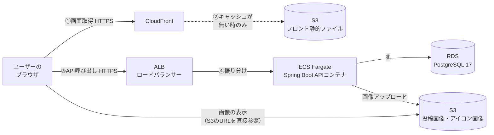

# インフラ構成図（前提版）

## RaiseTimeLine（仮称）

| 項目 | 内容 |
|------|------|
| ステータス | **前提構成**（ネットワーク設計・デプロイ手順の詳細はデプロイフェーズで確定する） |
| 確定事項 | 画像保存に **AWS S3** を使用する（**2026-09-02 実装完了**。詳細は「5. S3の確定仕様」） |
| 前提事項 | フロント配信は **S3 + CloudFront**、バックエンドは **ECS Fargate**、DBは **RDS（PostgreSQL）**、API入口は **ALB**。**EC2は使用しない**（2026-10-13 講義No.38で方針確定。経緯は「2.5 EC2不採用の経緯」） |

> 本書は要件定義時点の「前提となる構成図」。デプロイフェーズで、
> 具体的なネットワーク設計（VPC・サブネット）・セキュリティグループ・ECSタスク定義・デプロイ手順を追記して確定させる。
> **S3（画像保存用）の部分のみ、実際のリソースを作成して確定済み。**

---

## 1. 構成図（前提）

> 番号①〜⑤は「投稿が表示されるまでのリクエストの流れ」の順番（講義No.38の技術解説で使用した図と対応）。

### 各コンポーネントの役割

| コンポーネント | 役割 | 補足 |
|--------------|------|------|
| CloudFront | フロント静的ファイル（HTML/CSS/JS）のCDN配信 | 世界中の拠点にキャッシュを置き、近い拠点から配信する。HTTPSの終端もここ |
| S3（フロント用） | React ビルド成果物の置き場 | CloudFrontのキャッシュが無い時だけ取りに行かれる「元データ」。画像用S3とは別バケット |
| ALB（Application Load Balancer） | ユーザーからのAPIリクエストを受け、ECS Fargateのコンテナに振り分ける入口 | 「今動いている係員（コンテナ）」を把握して振り分ける |
| ECS Fargate | Spring Boot（REST API）をコンテナとして動かす実行環境 | サーバー（EC2のような土台）の存在を意識せずコンテナを動かせる。詳細は「2.5」 |
| RDS（PostgreSQL） | データベースのマネージドサービス | バックアップ・パッチ適用を AWS が管理してくれる |
| S3（画像用） | 投稿画像・アイコン画像の保存先（**確定**） | 画像はS3のURLで直接配信する想定。詳細は「5. S3の確定仕様」 |

> **ロードバランサーを入れる理由（学習メモ）:** 本来は複数サーバーへの負荷分散が目的だが、
> サーバー1台でも「HTTPSの終端」「ヘルスチェック」「将来の台数追加への備え」として入れる構成が実務では一般的。

---

## 2.5 EC2不採用の経緯

要件定義時点ではEC2を前提としていたが、講義No.38（2026-10-13）で ECS Fargate を採用する方針に変更した。

| 案 | 内容 | 判断 |
|----|------|------|
| **採用: ECS Fargate** | コンテナの実行環境をAWSに任せる | サーバー（OS）のパッチ適用・スケーリング設定を自分で管理する必要がなく、学習コスト・運用負荷の両方で有利 |
| 却下: EC2上に自分でAPIサーバーを構築 | EC2インスタンス上でSpring Bootを直接動かす | OSの保守・スケーリングを自前で管理する必要があり、構成がEC2単体に固定されると将来の台数追加や入れ替えがしにくい |

> **却下したが記録として残す理由:** 前回課題（TaskManagement）までEC2前提で設計してきた経緯があり、
> 「なぜ今回はEC2を使わないのか」を後から見返せるようにしておく。

---

## 2. ローカル開発環境との対応

| 役割 | ローカル開発 | 本番（前提） |
|------|-------------|------------|
| フロントエンド | Vite 開発サーバー（ポート5173） | ビルド成果物をS3 + CloudFrontで配信 |
| バックエンド | Spring Boot（ポート8080） | ECS Fargate上のコンテナでSpring Boot |
| データベース | Docker の PostgreSQL 17（ポート5432） | RDS（PostgreSQL 17） |
| 画像保存 | 既定は**ローカル保存**（`backend/uploads/`）。`APP_STORAGE_TYPE=s3` でS3にも切替可能 | S3（確定） |

---

## 3. 未確定事項（デプロイフェーズで決定）

| # | 未確定事項 | 選択肢の例 |
|---|-----------|-----------|
| 1 | VPC・サブネット設計 | パブリック/プライベートサブネットの分割、ECS・RDSの配置先 |
| 2 | ECS Fargateのタスク定義 | CPU・メモリサイズ、タスク数（最小構成でいくつ動かすか） |
| 3 | 独自ドメイン・DNS | Route 53 を使うか、ALB/CloudFrontのDNS名をそのまま使うか |
| 4 | Terraformのコード構成 | 前回課題（TaskManagement）と同じ構成を使うか、モジュール分割の単位 |

> **旧「S3への画像アップロード方式」は確定した**（バックエンド経由）。下記「5. S3の確定仕様」を参照。

---

## 4. デプロイ手順

デプロイフェーズで追記する（未作成）。

---

## 5. S3の確定仕様（2026-09-02 実装・実機検証済み）

### リソース

| 項目 | 値 |
|------|-----|
| バケット名 | `raisetimeline-dev-578760237100` |
| リージョン | `ap-northeast-1`（東京） |
| バージョニング | **無効**（有効だと削除しても実体が残り、課金が積み上がるため） |
| 暗号化 | S3の既定（`AES256`）をそのまま使用 |
| IAMユーザー | `raisetimeline-app`（アプリ専用。`Administrator` は使わない） |
| IAMポリシー | `RaiseTimeLineS3Access` |

> バケット名にアカウントIDを含めているのは、S3のバケット名が**全世界で一意**である必要があるため。

### IAMポリシー（最小権限）

対象バケット以外には一切アクセスできない。

| 許可 | 対象 |
|------|------|
| `s3:PutObject` / `s3:GetObject` / `s3:DeleteObject` | `arn:aws:s3:::raisetimeline-dev-578760237100/*` |
| `s3:ListBucket` | `arn:aws:s3:::raisetimeline-dev-578760237100` |

`s3:ListAllMyBuckets` や IAM 操作の権限は与えていない（実際に拒否されることを検証済み）。

### 公開方針

| 設定 | 値 | 理由 |
|------|-----|------|
| `BlockPublicAcls` / `IgnorePublicAcls` | **true（塞いだまま）** | ACLによる意図しない公開を防ぐ |
| `BlockPublicPolicy` / `RestrictPublicBuckets` | false | バケットポリシーで読み取りのみ許可するため |
| バケットポリシー | `s3:GetObject` のみ匿名許可 | `` はブラウザが認証情報を送れないため |

**受け入れたトレードオフ:** URLを知っていればログインなしで画像を閲覧できる。
バケットの一覧取得は匿名に許可していないためキーの推測はできないが、
「投稿画像はURLさえあれば誰でも見られる」状態であることを前提とする。

- **却下案: 署名付きURL（presigned URL）** — より安全だが、`StorageService#toPublicUrl(String): String` に
  有効期限を表現できずシグネチャが合わない。呼ぶたびURLが変わるためブラウザの画像キャッシュも効かなくなる

### アプリ側の切り替え

| 環境 | 設定 | 認証情報 |
|------|------|---------|
| 通常のローカル開発 | **何も設定しない**（既定で `local`） | AWSの認証情報すら不要 |
| ローカルでS3を検証 | `APP_STORAGE_TYPE=s3` / `APP_STORAGE_S3_BUCKET=...` | `AWS_PROFILE=raisetimeline` |
| 将来のECS Fargate | 同上 | **タスクロール**（IAMロールの一種。アクセスキー自体が不要になる） |

`DefaultCredentialsProvider` が「環境変数 → プロファイル → ECSのタスクロール」の順で自動探索するため、
**3環境すべてでコードは同一**。アクセスキーは `~/.aws/credentials`（リポジトリ外）にのみ置く。

### コスト管理

既存の AWS Budgets「AWSコスト上限アラート」（月$1・**実績が$0.01を超えた時点で**メール通知）を見張りに使う。
計画時は $5 のBudgetを新設する予定だったが、既存のものの方が条件が厳しいため新設は見送った。
